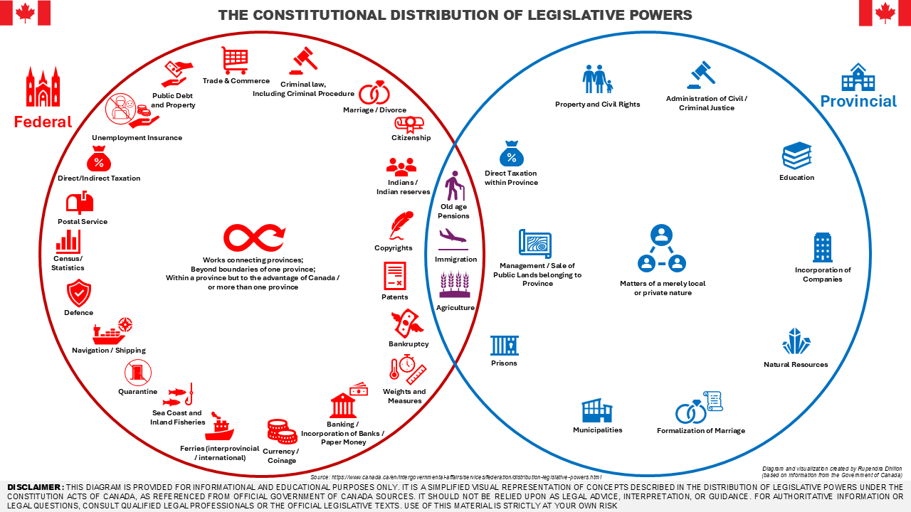

The division of powers between Canada’s Federal and Provincial governments is one of the most important, yet most misunderstood aspects of our constitutional system. Citizens, policymakers, and even seasoned professionals often struggle to recall which order of government is responsible for which areas of law and public service. This simplified diagram draws from the [_Government of Canada’s explainer on the distribution of legislative powers_](https://www.canada.ca/en/intergovernmental-affairs/services/federation/distribution-legislative-powers.html) and pairs it with clear, accessible iconography to help readers quickly grasp the core responsibilities at each level of government.

Download PDF version [here](/downloads/Northern%20Compass/2025-08-30-who-does-what-understanding-federal-and-provincial-powers-in-canada/Federal+vs+Provincial+Powers.pdf).

